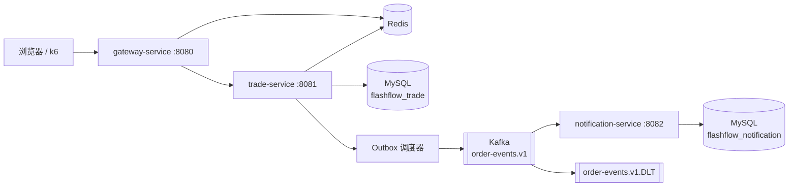
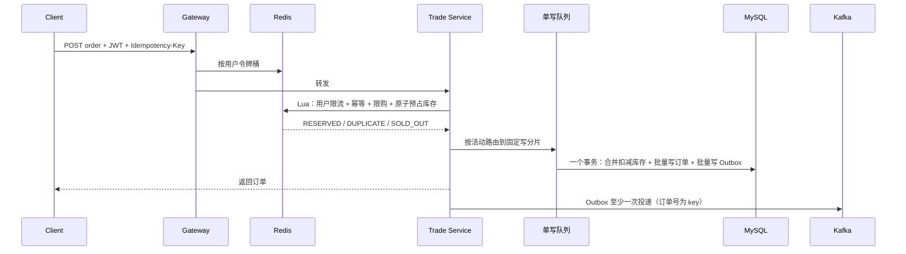

# FlashFlow 高并发限量购与订单履约平台

[](https://github.com/HHqm/FlashFlow/actions/workflows/ci.yml)

FlashFlow 是一个面向 Java 后端求职作品集的生产化微服务电商项目：用户商城 + 运营后台 + 网关 + 交易服务 + 异步通知服务。它围绕“限量商品抢购”实现 Redis Lua 原子预占、MySQL 最终防超卖、单写队列微批量落库、事务 Outbox、Kafka 至少一次投递、Inbox 消费幂等、库存补偿任务与自动对账，并用真实中间件集成测试和 k6 压测给出可复现的数据。

## 结果速览

以下数字全部来自仓库内脚本在本机 Docker Compose 单实例环境中的实测，复现方法见 [测试与压测](#测试与压测)。

| 维度 | 结果 |
| --- | --- |
| 防超卖 | 1 万名买家以 2,000 次/秒各抢 2 次、争抢 1,000 件：恰好成交 1,000 单、每人最多 1 单，MySQL 与 Redis 余量均为 0 |
| 吞吐 | 2 万个独立买家、默认限流，1,000 次/秒持续下单 2 万次全部成功，P95 37 ms、零错误 |
| 幂等 | 同一幂等键并发提交 1,001 次只生成 1 笔订单、只扣 1 件库存 |
| 限流 | 单个买家以 100 次/秒狂刷 10 秒只成交 55 单（约 5 单/秒），其余 429，零 5xx |
| 故障恢复 | 500 次/秒压测中 `SIGKILL` 交易服务：无超卖，被截断的 2 件预占在流量停止 31 秒后被对账任务自动修复 |
| 性能优化 | 多买家压测暴露单用户压测掩盖的热路径数据库往返，用 JFR 定位并优化后，同口径 500 次/秒的 P95 从 5.4 s 降至 238 ms |
| 自动化测试 | 66 个测试；其中 5 个集成测试用 Testcontainers 启动真实 MySQL 8.4、Redis 8.4、Kafka 4.3，覆盖并发抢购、幂等重放、Kafka 投递、`docker pause` 冻结 Redis 的故障注入和库存对账 |

## 解决的工程问题

1. 高并发下如何不超卖，同时不让热点库存行拖垮数据库；
2. 客户端重试时如何只创建一笔订单；
3. 数据库提交成功后，消息如何不丢；Kafka 重复投递时，下游如何不重复执行；
4. 取消、超时、退款后 Redis 回补失败，如何不让活动提前“售罄”；
5. 发货、收货、退款与评价如何通过状态机避免越权和非法跳转；
6. 性能数字如何可复现、可解释，而不是一次性的截图。

## 技术栈

| 层次 | 技术 |
| --- | --- |
| 语言与框架 | Java 21、Spring Boot 4.1、Spring Cloud 2025.1 |
| 网关与安全 | Spring Cloud Gateway、Spring Security、JWT、Redis 令牌桶 |
| 数据存储 | MySQL 8.4、Spring Data JPA、Flyway |
| 缓存与并发 | Redis 8、Lua 原子脚本、分布式锁、幂等键、单写队列 |
| 消息系统 | Apache Kafka 4.3、事务 Outbox、Inbox 去重、DLT |
| 前端 | Vue 3、TypeScript、Vite |
| 质量与运维 | JUnit 5、Testcontainers、k6、JFR、Actuator、Prometheus 告警规则、Docker Compose、GitHub Actions |

## 系统结构



- `gateway-service`：统一路由、JWT 校验、按用户的 Redis 令牌桶限流、Trace ID 透传；
- `trade-service`：登录、类目、SPU/SKU、检索、地址簿、秒杀活动、库存预占、订单、支付、发货/收货、退款售后、评价、Outbox、库存补偿与对账；
- `notification-service`：Kafka 批量消费、Inbox 幂等、站内通知、失败重试与死信；
- `flashflow-common`：版本化跨服务事件契约，不共享数据库实体。

## 核心设计

### 下单链路



- **Redis Lua** 把“查幂等、查限购、查库存、扣库存、记幂等映射”合并为一次原子执行，售罄和超限请求不进数据库；
- **单写队列 + 微批量**：同一活动只由一个写线程处理，8 ms 窗口内最多合并 64 单，一次 `remaining_stock >= 总数量` 条件更新扣减库存，订单和 Outbox 用 JDBC 批量插入；
- **MySQL 条件更新是最终防超卖屏障**：Redis 即使因故障或误操作多放行，合并批次也会失败；此时批次二分拆分重试，只让放得下的订单成交，额外开销 O(log n)；
- **事务 Outbox**：订单与事件同事务提交，Producer `acks=all` + 幂等发送；消费端以 `event_id` 主键做 Inbox 去重，失败 3 次进入 DLT。

### 库存自愈闭环

取消、超时关单、退款通过都会在 MySQL 回补库存，Redis 回补失败时活动会提前“售罄”。系统按故障层级设置三道防线：

1. **补偿任务**：在回补 MySQL 的同一事务中写入 `stock_compensation_task`，提交后立即执行；失败按指数退避重试，耗尽后告警并可在后台手动重试；
2. **幂等脚本**：补偿 Lua 按订单号判断，重复执行返回 `NOOP`，所以超时重试、并发重试都只回补一次；
3. **定时对账**：同一漂移在静默窗口（默认 30 s）内行版本号与 Redis 值都不变才视为真实泄漏，用 Lua CAS 修复并写审计日志；缓存 key 缺失只告警不自动预热。

运营后台“库存对账”页面可以查看每个活动的 MySQL/Redis 库存、补偿任务和修复记录。完整推导见 [架构说明 §8.1](docs/architecture.md#81-库存自愈闭环)。

## 测试与压测

### 自动化测试

| 层级 | 工具 | 内容 |
| --- | --- | --- |
| 单元测试 | JUnit 5、Mockito、H2 | 状态机、限购、补偿退避、对账判定、批次拆分、写入顺序、UUIDv7 |
| 集成测试（`*IT`） | Testcontainers：MySQL 8.4、Redis 8.4、Kafka 4.3 | 真实 Flyway 迁移；HTTP → JWT → Lua → 单写队列 → MySQL → Outbox → Kafka |

集成测试场景：120 人抢 30 件恰好 30 单；同一幂等键并发 40 次只生成 1 单；30 条订单事件全部以订单号为 key 进入 Kafka；冻结 Redis 时取消订单，恢复后库存恰好回补一次；人为制造 3 件库存泄漏，首轮只观察、次轮 CAS 修复；零静默窗口的激进对账与 150 个并发买家同时运行仍不超卖、不少卖。

```bash
./mvnw clean verify          # 单元测试 + 集成测试（需要 Docker）
./mvnw -pl trade-service -am test   # 只跑单元测试
```

### 压测结果

环境：AMD Ryzen 9 8940HX（16 核 32 线程）、Docker Desktop、各服务与中间件单实例；k6 与服务同机，在 compose 网络内直连网关；2 万个独立买家，默认限流配置。

| 场景 | 速率 | 请求 | 成功 | 售罄 / 超限购 / 429 | 5xx | 成功 P95 | 成功 P99 | 超卖 |
| --- | ---: | ---: | ---: | --- | ---: | ---: | ---: | --- |
| 持续下单 | 500/s | 10,000 | 10,000 | 0 / 0 / 0 | 0 | 29.6 ms | 170.7 ms | 否 |
| 持续下单 | 800/s | 16,000 | 16,000 | 0 / 0 / 0 | 0 | 33.1 ms | 48.4 ms | 否 |
| 持续下单 | 1,000/s | 20,001 | 20,000 | 0 / 1 / 0 | 0 | 37.3 ms | 52.0 ms | 否 |
| 热点抢购（1,000 件） | 2,000/s | 20,002 | 1,000 | 18,000 / 1,002 / 0 | 0 | 124.7 ms | 139.4 ms | 否 |
| 单用户狂刷 | 100/s | 1,001 | 55 | 0 / 0 / 946 | 0 | 24.7 ms | 26.7 ms | 否 |
| 强杀交易服务 | 500/s | 19,136 | 12,355 | 停机期间 6,781 次 5xx | — | — | — | 否，31 s 后自动修复 |

每个场景结束后都核对：`成交数量 = 总库存 − MySQL 余量`、MySQL 余量 = Redis 余量、每个买家最多 1 单、Outbox 积压清零。

**瓶颈定位与优化**（同口径对比，压测器经宿主机端口访问）：

| 目标速率 | 优化前 P95 | 优化后 P95 | 优化前实际速率 | 优化后实际速率 |
| ---: | ---: | ---: | ---: | ---: |
| 300/s | 2,727 ms | 135 ms | 242/s | 299/s |
| 500/s | 5,362 ms | 238 ms | 258/s | 498/s |

JFR 显示时间花在 MySQL 往返而不是 CPU：地址快照每单开一次只读 JPA 事务（约 7 次往返，单用户压测因缓存命中而看不到）、Outbox 每条事件多一次 `merge` 查询、`IDENTITY` 主键让订单无法批量插入。对应改为单条自动提交 SQL、`Persistable` 实体、号段主键批量插入，并加上 UUIDv7 事件 ID、连接会话状态缓存与 Outbox 保留期清理。

### 复现压测

```bash
docker compose up -d --build
bash load-test/run-suite.sh                     # 全部场景，约 10 分钟
RATES="300 500" bash load-test/run-suite.sh throughput hotsale   # 指定场景
```

脚本会自动创建 2 万个无法登录的压测买家并签发 JWT，k6 在 compose 网络内直接访问网关，每个场景结束后核对 MySQL 剩余库存、Redis 库存、订单数、每个买家的订单数和 Outbox 积压，结果写入 `load-test/results/<suite>/summary.md`。完整报告与瓶颈分析见 [性能测试报告](docs/performance-test-2026-11-01.md)。

## 商城与运营能力

- **用户前台**：按名称、类目、颜色和规格搜索商品，按价格或评分排序；查看 SKU、原价、秒杀价、库存、限购和已购评价；
- **交易履约**：地址簿与不可变地址快照；支付、发货、确认收货、主动取消、退款申请；确认收货后可发表一次 1～5 星评价；
- **运营后台**：类目、SPU/SKU、售价与库存、秒杀活动（活动价、活动库存、限购、时段、启停、预热）、订单发货、退款审批、评价审核与回复、库存对账；
- **权限边界**：`ADMIN` 只能管理商城、订单和售后，`USER` 才能购买、取消、退款和评价自己的订单；商品或 SKU 下架会自动暂停关联活动。


## 一键运行

需要 Docker Desktop（建议 Docker Compose 2.20+）：

```bash
git clone https://github.com/HHqm/FlashFlow.git
cd FlashFlow
docker compose up -d --build
# 同时启动 Kafka UI 和 Prometheus（含告警规则）
docker compose --profile tools up -d --build
```

| 地址 | 用途 |
| --- | --- |
| `http://localhost:3000` | 前端：用户商城与运营后台 |
| `http://localhost:8080` | API 网关 |
| `http://localhost:8081/actuator/health` | 交易服务健康检查 |
| `http://localhost:8082/actuator/health` | 通知服务健康检查 |
| `http://localhost:8090` | Kafka UI（tools profile） |
| `http://localhost:9090` | Prometheus（tools profile） |

首次启动会创建演示账号（仅用于本地，生产环境应关闭 `DEMO_DATA_ENABLED` 并替换所有默认密钥）：

| 用户 | 密码 | 角色 |
| --- | --- | --- |
| `demo` | `Demo@123456` | USER |
| `admin` | `Admin@123456` | ADMIN |

逐步操作见 [快速开始教程](docs/quickstart.md)，接口可直接用 IntelliJ IDEA 运行 [接口请求集](docs/api.http)。

## 目录

```text
FlashFlow/
├── flashflow-common/       # 版本化事件契约（UUIDv7 事件 ID）
├── gateway-service/        # 网关、JWT、按用户限流、Trace ID
├── trade-service/          # 秒杀、订单、售后、Outbox、库存补偿与对账
├── notification-service/   # Kafka Consumer、Inbox、DLT
├── frontend/               # Vue 3 用户商城与运营后台
├── docker/                 # MySQL 初始化、Prometheus 配置与告警规则
├── docs/                   # 架构、接口、性能报告、面试与简历材料
├── load-test/              # k6 场景、压测买家生成、一键压测与结果核对
└── compose.yml             # 本地完整环境
```

## 文档

- [架构说明](docs/architecture.md)：一致性、库存自愈、扩展和生产化取舍；
- [性能测试报告](docs/performance-test-2026-11-01.md)：多买家压测、瓶颈定位过程与优化前后对比（[早期单用户报告](docs/performance-test-2026-08-12.md)）；
- [面试追问手册](docs/interview-guide.md)：组件选择、边界与故障处理；
- [简历项目描述](docs/resume.md)：可直接使用、每条都有代码和测试佐证的描述；
- [OpenAPI 契约](docs/openapi.yaml)：主要外部接口定义。

所有性能数字都依赖机器、Docker 资源和参数，请在自己的环境运行 `load-test/run-suite.sh` 后再引用，并保留“本机 Docker 单实例”等限定条件。

## License

[MIT](LICENSE)
