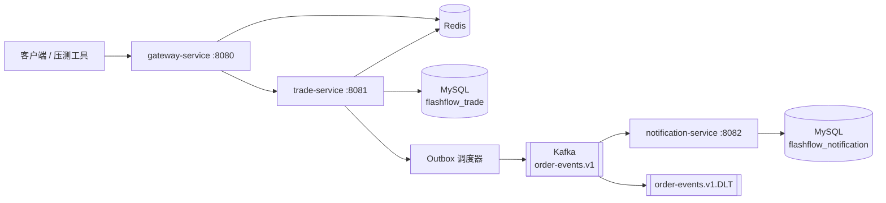
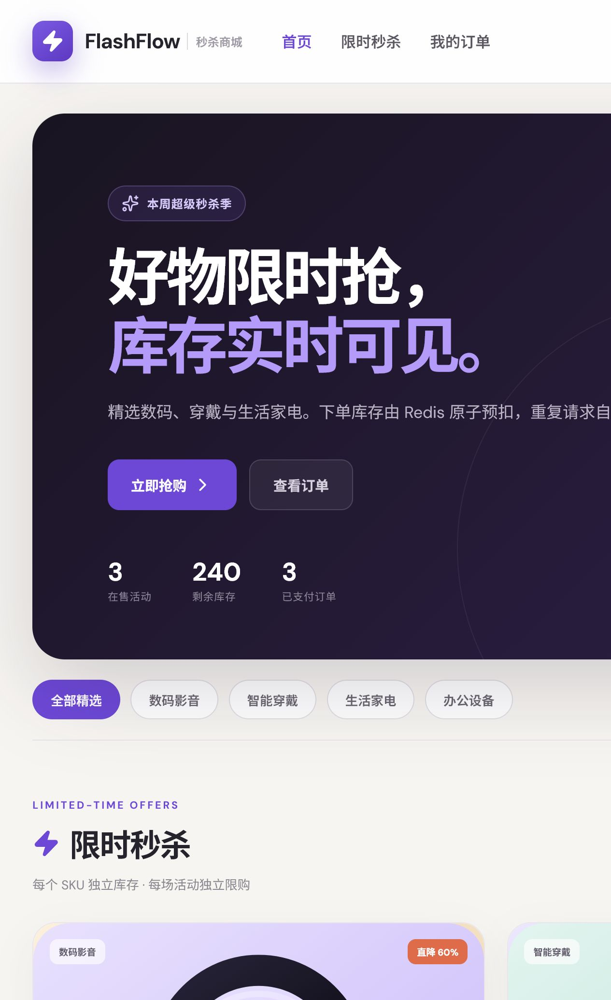
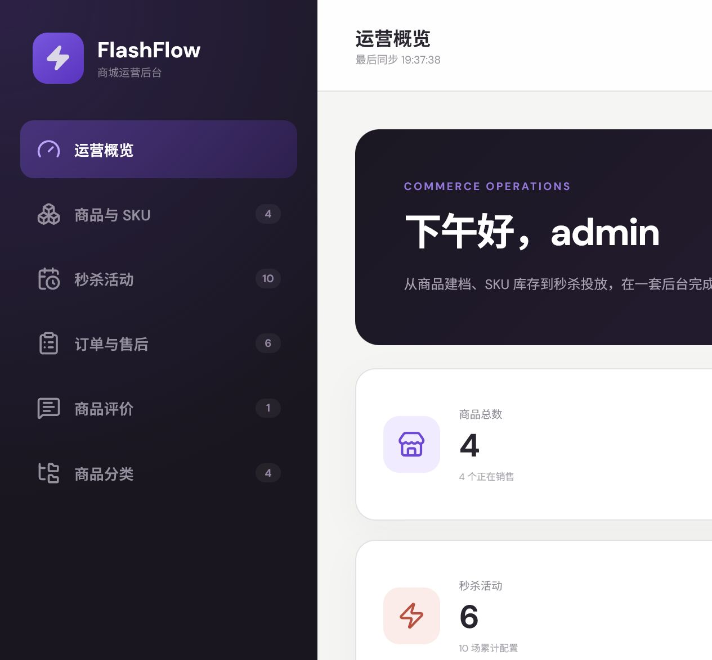
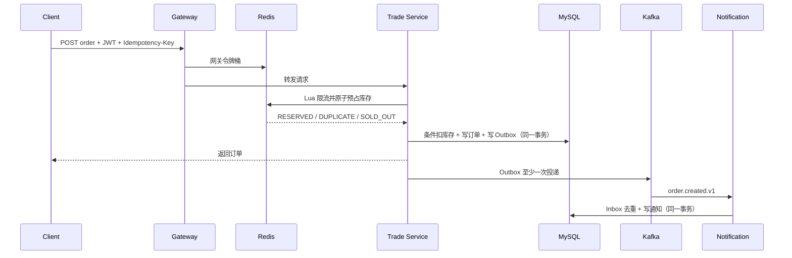

# FlashFlow 高并发限量购与订单履约平台

FlashFlow 是一个面向 Java 后端求职作品集的生产化微服务电商项目。它既实现商品检索、SKU、订单、取消、退款售后、已购评价和运营审核等商城闭环，也围绕“限量商品抢购”实现网关鉴权、Redis 原子预占、MySQL 最终扣减、事务 Outbox、Kafka 异步解耦、消费幂等、失败重试、死信队列和库存补偿。

FlashFlow 是一套带前台商城、运营后台和高并发秒杀链路的 Java 电商项目，重点覆盖以下工程问题：

1. 高并发下如何不超卖；
2. 重复请求如何只创建一笔订单；
3. 数据库提交成功后，消息如何不丢；
4. Kafka 重复投递时，下游如何不重复执行；
5. 订单取消、退款审批和库存回补如何保持状态一致；
6. 评价如何保证来自真实已购用户并支持运营审核。

## 技术栈

| 层次 | 技术 |
| --- | --- |
| 语言与框架 | Java 21、Spring Boot 4.1、Spring Cloud 2025.1 |
| 网关与安全 | Spring Cloud Gateway、Spring Security、JWT、Redis 令牌桶 |
| 数据存储 | MySQL 8.4、Spring Data JPA、Flyway |
| 缓存与并发 | Redis 8、Lua 原子脚本、分布式锁、幂等键 |
| 消息系统 | Apache Kafka 4.3、事务 Outbox、Inbox 去重、DLT |
| 工程能力 | Maven 多模块、Docker Compose、Actuator、Prometheus、JaCoCo、GitHub Actions |

Spring Boot 4.1 要求 Java 17 及以上，项目选择招聘中更常见的 Java 21 LTS 作为编译基线。版本依据可查阅 [Spring Boot 官方文档](https://docs.spring.io/spring-boot/) 和 [Spring Cloud 官方兼容矩阵](https://spring.io/projects/spring-cloud/)。

## 系统结构



服务职责：

- `gateway-service`：统一路由、JWT 校验、Redis 分布式限流、Trace ID 透传；
- `trade-service`：用户登录、类目、SPU/SKU、商品检索、秒杀活动、库存预占、订单、支付、取消、退款售后、已购评价、Outbox；
- `notification-service`：Kafka 消费、Inbox 幂等、站内通知、失败重试与死信；
- `flashflow-common`：版本化跨服务事件契约，不共享数据库实体。

更完整的设计与故障分析见 [架构说明](docs/architecture.md)。

## 商城与运营能力

系统按“前台用户、后台运营”分离职责：

- 用户前台：按名称、类目、颜色和规格搜索商品，按价格或评分排序；查看颜色/规格 SKU、原价、秒杀价、库存、限购和已购评价；
- 交易履约：选择数量下单和支付，待支付订单可主动取消；已支付订单可发起退款申请、查看进度，并在成交后发表一次 1～5 星真实评价；
- 运营后台：创建和启停类目，创建含多个颜色/规格 SKU 的商品，追加 SKU，独立维护售价、库存和状态，控制商品上架/下架；
- 秒杀运营：选择具体 SKU 创建活动，配置活动价、活动库存、每人限购量和起止时间，控制活动启停并预热 Redis；
- 订单与售后：管理员查看全量订单，审批或驳回退款并记录处理意见；审批成功后同步迁移订单状态、恢复 MySQL 活动库存并补偿 Redis；
- 评价运营：管理员查看真实买家和关联订单，隐藏/恢复评价并发表商家回复；前台只聚合可见评价的平均分和数量；
- 库存边界：创建秒杀活动时从 SKU 可售库存划拨活动库存，Redis Lua 按购买数量原子预扣，并由 MySQL 条件更新提供最终防超卖屏障；
- 权限边界：`ADMIN` 只能管理商城、订单和售后，`USER` 才能购买、取消、退款和评价自己的订单；商品或 SKU 下架会自动暂停关联活动。

本轮功能取舍参考了 [macrozheng/mall](https://github.com/macrozheng/mall) 的前后台领域划分、[Medusa Commerce Modules](https://docs.medusajs.com/resources/commerce-modules) 的模块化电商领域、[Adobe Commerce 退货工作流](https://experienceleague.adobe.com/en/docs/commerce-admin/stores-sales/order-management/returns/returns) 与[商品评价管理](https://experienceleague.adobe.com/en/docs/commerce-admin/marketing/merchandising/product-reviews/product-reviews)。当前版本优先实现可演示、可验证的一致交易闭环，而不是堆叠彼此割裂的菜单。

## 页面截图

用户商城支持商品搜索、分类筛选、秒杀下单、订单查看、退款申请、评价和站内通知：



管理员后台支持商品/SPU/SKU、秒杀活动、订单售后、评价审核和分类运营：



完整本地使用流程见 [快速开始教程](docs/quickstart.md)。

## 一键运行

需要 Docker Desktop（建议 Docker Compose 2.20+）：

```bash
docker compose up -d --build
```

同时启动 Kafka UI 和 Prometheus：

```bash
docker compose --profile tools up -d --build
```

启动后可访问：

| 地址 | 用途 |
| --- | --- |
| `http://localhost:8080` | API 网关 |
| `http://localhost:8080/actuator/health` | 网关健康检查 |
| `http://localhost:3000` | FlashFlow 前端演示控制台 |
| `http://localhost:8081/actuator/health` | 交易服务健康检查 |
| `http://localhost:8082/actuator/health` | 通知服务健康检查 |
| `http://localhost:8090` | Kafka UI（tools profile） |
| `http://localhost:9090` | Prometheus（tools profile） |

首次启动会创建演示数据：

| 用户 | 密码 | 角色 |
| --- | --- | --- |
| `demo` | `Demo@123456` | USER |
| `admin` | `Admin@123456` | ADMIN |

这些账号只用于本地演示，生产环境应关闭 `DEMO_DATA_ENABLED` 并替换所有默认密钥。

## 跑通一次完整交易

以下命令适用于 PowerShell。

登录并保存 JWT：

```powershell
$body = @{ username = "demo"; password = "Demo@123456" } | ConvertTo-Json
$login = Invoke-RestMethod -Method Post `
  -Uri "http://localhost:8080/api/v1/auth/login" `
  -ContentType "application/json" `
  -Body $body
$token = $login.data.accessToken
```

查询活动：

```powershell
$campaigns = Invoke-RestMethod `
  -Uri "http://localhost:8080/api/v1/campaigns"
$campaignId = $campaigns.data[0].id
```

创建订单：

```powershell
$headers = @{
  Authorization = "Bearer $token"
  "Idempotency-Key" = [guid]::NewGuid().ToString("N")
}
$order = Invoke-RestMethod -Method Post `
  -Uri "http://localhost:8080/api/v1/campaigns/$campaignId/orders" `
  -Headers $headers `
  -ContentType "application/json" `
  -Body (@{ quantity = 1 } | ConvertTo-Json)
$orderNo = $order.data.orderNo
```

模拟支付：

```powershell
Invoke-RestMethod -Method Post `
  -Uri "http://localhost:8080/api/v1/orders/$orderNo/pay" `
  -Headers @{ Authorization = "Bearer $token" }
```

查看 Kafka 异步生成的站内通知：

```powershell
Invoke-RestMethod `
  -Uri "http://localhost:8082/internal/notifications?userId=1"
```

IntelliJ IDEA 用户也可以直接运行 [接口请求集](docs/api.http)。

## 一致性设计

下单成功链路：



关键保证：

- Redis Lua 把“查库存、扣库存、用户限购、幂等键”合并为一个原子操作；
- MySQL 使用 `remaining_stock >= quantity` 的按数量条件更新作为最终防超卖屏障；
- 订单与 Outbox 事件写入同一个本地事务，消除“订单成功但消息丢失”的双写窗口；
- Producer 开启 `acks=all` 和幂等发送，Outbox 失败按指数退避重试；
- Consumer 使用 `processed_message.event_id` 主键实现 Inbox 去重；
- 消费连续失败 3 次进入 `.DLT`，避免毒消息阻塞正常分区；
- 15 分钟未支付订单自动取消，MySQL 恢复库存，再补偿 Redis。

## 常用命令

```bash
# 编译和测试全部模块
./mvnw clean verify

# 仅运行交易服务测试
./mvnw -pl trade-service -am test

# 查看服务日志
docker compose logs -f gateway-service trade-service notification-service

# 停止服务，保留数据卷
docker compose down

# 停止并删除本项目的数据卷（会删除本地演示数据）
docker compose down -v
```

Windows 可将 `./mvnw` 替换为 `.\mvnw.cmd`。

## 目录

```text
flashflow-platform/
├── flashflow-common/       # 版本化事件契约
├── gateway-service/        # 网关、JWT、限流、Trace ID
├── trade-service/          # 限量购、订单、支付、Outbox、超时关单
├── notification-service/   # Kafka Consumer、Inbox、DLT
├── docker/                 # MySQL 初始化与 Prometheus 配置
├── docs/                   # 架构、接口、面试与简历材料
├── load-test/              # k6 热点保护压测脚本
└── compose.yml             # 本地完整环境
```

## 求职材料

- [简历项目描述](docs/resume.md)：可按实际压测结果替换占位数字；
- [面试追问手册](docs/interview-guide.md)：解释组件选择、边界与故障处理；
- [OpenAPI 契约](docs/openapi.yaml)：主要外部接口定义；
- [架构说明](docs/architecture.md)：一致性、扩展和生产化取舍。

请不要在未实际压测前声称具体 QPS。先运行 [k6 脚本](load-test/seckill-hot-key.js)，将机器配置、并发数、成功率、P95/P99 与数据库库存核对结果记录下来，再写进简历。
