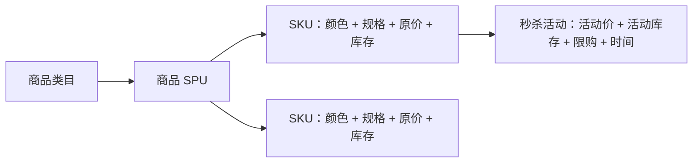
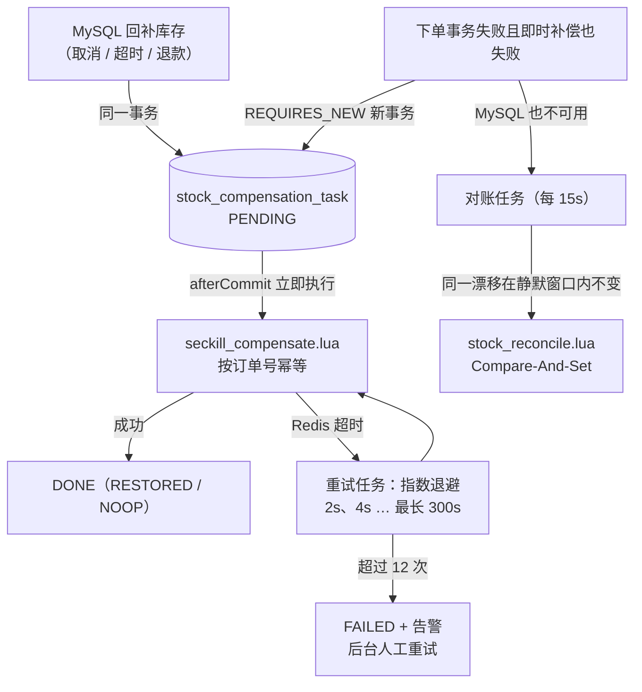
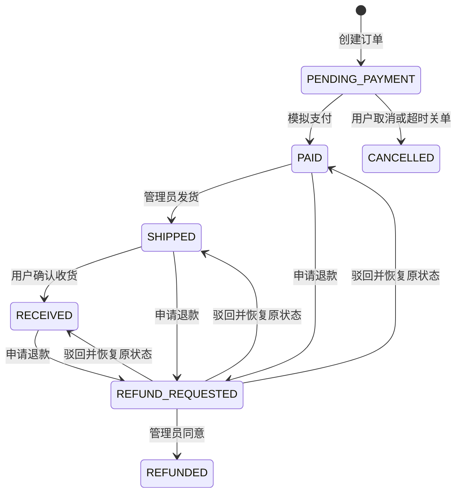

# FlashFlow 架构与关键设计

## 1. 业务目标

系统在限量商品瞬时高并发场景下满足以下约束：

- 库存不能为负，MySQL 不允许超卖；
- 商品按类目、SPU、SKU 建模，颜色与规格库存彼此独立；
- 用户单次购买数量和活动累计购买数量都不能超过运营配置的限购上限；
- 下单必须校验地址归属并保存地址快照，历史订单不受地址簿后续修改影响；
- 相同 `Idempotency-Key` 重放必须返回同一订单语义；
- 订单事务成功后，领域事件最终必须进入 Kafka；
- Kafka 的重复投递不能生成重复通知；
- 中间件故障要快速失败或可恢复，不能悄悄降级为不安全路径。

## 2. 商品域与角色边界

商城商品域分为四层：



- 类目负责前台导航和后台商品归类；
- SPU 保存商品名称、介绍、图片和整体上下架状态；
- SKU 保存编码、颜色、规格、原价、可售库存及独立启停状态；
- 秒杀活动只绑定一个具体 SKU，创建时从 SKU 可售库存划拨活动库存；
- 商品或 SKU 下架会自动暂停关联活动，避免下架商品继续成交；
- `ADMIN` 只管理类目、商品、SKU 和活动，`USER` 才能创建、查询和支付自己的订单。

## 3. 为什么先 Redis、再 MySQL

如果所有请求直接竞争数据库行锁，热点活动会把并发压力集中到单行。FlashFlow 先用 Redis Lua 原子预占，把绝大多数售罄、重复购买和超频请求挡在数据库外；成功预占的少量请求再进入 MySQL。

MySQL 仍然执行：

```sql
UPDATE flash_campaign
SET remaining_stock = remaining_stock - :quantity
WHERE id = :campaignId
  AND remaining_stock >= :quantity
  AND status = 'ACTIVE';
```

只有影响行数为 1 才创建订单。因此 Redis 是流量削峰与快速判定层，MySQL 是最终事实与防超卖屏障。Redis 不可用时系统返回 503，不绕过预占直接写库。

## 4. Redis Lua 原子区

`seckill_reserve.lua` 在一次 Redis 执行中完成：

1. 查询请求幂等键；
2. 读取用户在该活动的累计购买量；
3. 校验本次数量是否超过个人限购；
4. 校验活动缓存库存是否充足；
5. 按数量扣减库存并累加用户购买量；
6. 写请求到订单号的映射。

这避免了多次 Redis 命令之间的竞态。脚本只存订单号，不存完整订单，订单事实仍由 MySQL 管理。

若后续数据库事务失败，`seckill_compensate.lua` 会先核对请求映射中的订单号，再按原购买数量恢复库存、回退用户累计购买量并删除本次幂等映射，防止错误补偿其他请求。脚本返回 1 表示已回补、0 表示已回补过或预占已过期，因此可以安全地重复执行——这是后文“补偿任务可以反复重试”的前提。

## 5. 幂等边界

系统使用三层幂等：

| 层 | 键 | 作用 |
| --- | --- | --- |
| HTTP | `Idempotency-Key` | 处理客户端超时重试 |
| 订单 | `UNIQUE(user_id, idempotency_key)` | 数据库最终兜底 |
| 消费 | `processed_message.event_id` 主键 | 处理 Kafka 至少一次投递 |

对于 Redis 已写入幂等映射、但订单事务尚未提交的极短窗口，重复请求返回 `REQUEST_PROCESSING` 和订单号，客户端稍后查询即可。

## 6. Transactional Outbox

直接在数据库事务中调用 Kafka 有两个不可原子化的资源：

- 数据库提交成功、Kafka 发送失败：订单存在但下游不知道；
- Kafka 发送成功、数据库回滚：下游收到不存在的订单。

FlashFlow 将完整事件先写入 `outbox_event`，与订单共享本地事务。后台调度器竞争 Redis 分布式锁，读取待投递事件并发送 Kafka；成功后标记 `PUBLISHED`，失败则指数退避，达到上限标记 `FAILED`。

发送与标记之间仍可能在进程崩溃时产生重复消息，这是刻意采用的“至少一次”语义。下游 Inbox 去重负责把它收敛为一次业务效果。

生产规模继续扩大时，可将轮询 Outbox 替换为 Debezium CDC。领域事件契约和消费者无需改变。

## 7. Kafka 分区、顺序与死信

- Kafka key 使用 `orderNo`，同一订单的创建、支付、取消事件进入同一分区；
- Topic 默认 6 个分区，可横向扩展 consumer group；
- Consumer 数据库事务成功后才返回，随后提交 offset；
- 业务处理失败固定间隔重试 3 次，再发送到 `.DLT`；
- DLT 应配置告警、人工检查、修复后重放流程。

Inbox 的 `event_id` 是业务幂等键，不能使用 Kafka offset，因为事件重放到新 Topic 后 offset 会改变。

## 8. 超时关单

调度任务查询 `PENDING_PAYMENT` 且超过支付窗口的订单，逐笔执行小事务：

1. 将订单置为 `CANCELLED`；
2. 按订单购买数量恢复 MySQL 活动库存；
3. 同事务写 `order.cancelled.v1` Outbox 和一条 `stock_compensation_task`；
4. 提交后立即执行 Redis 条件补偿，成功则把任务标记为 `DONE`。

如果第 4 步失败，MySQL 库存正确而 Redis 暂时偏少，只会少卖，不会超卖；补偿任务仍为 `PENDING`，由重试任务继续执行，见下一节。

## 8.1 库存自愈闭环

旧版本在 Redis 补偿失败时只记日志，Redis 会永久少于 MySQL，活动提前“售罄”。现在按故障层级设置三道防线：



1. **补偿任务表**：取消、超时关单、退款通过都在回补 MySQL 库存的同一事务中写入补偿任务，与 Outbox 是同一种思路——把“提交后要做的事”变成持久化记录。下单事务本身失败且即时补偿也失败时，用 `REQUIRES_NEW` 新事务落库；
2. **幂等重试**：任务按订单号唯一，Lua 脚本按订单号判断，重复执行返回 0（`NOOP`），所以重试任务、afterCommit 即时执行和人工重试即使并发也不会重复回补。集成测试证明了一个容易忽略的事实：客户端超时不等于 Redis 没有执行——冻结期间发出的命令可能在 Redis 恢复后照常执行，此时重试会落到 `NOOP`；
3. **定时对账**：作为最后一道防线，对账任务比较进行中活动的 Redis 库存与 MySQL `remaining_stock`。

对账的难点是“正常的在途预占”也会让 Redis 暂时小于 MySQL，不能一看到差异就修复：

| 情况 | 处理 |
| --- | --- |
| Redis = MySQL | `CONSISTENT` |
| 该活动仍有 `PENDING` 补偿任务 | `PENDING_COMPENSATION`，交给补偿任务 |
| 第一次看到差异 | `DRIFT_OBSERVED`，记录（行版本号，Redis 值，时间） |
| 静默窗口（默认 30s）内行版本号和 Redis 值都没变 | 用 `stock_reconcile.lua` 做 CAS：只有 Redis 仍等于观察值才写入 MySQL 值，并写入 `stock_reconciliation_log` |
| CAS 时 Redis 已变化 | `CAS_CONFLICT`，本轮放弃 |
| Redis key 缺失 | `MISSING_KEY` 只告警不自动预热，因为买家限购计数也随之丢失，需要运营确认 |

行版本号由 `decrementStock`/`incrementStock` 每次加 1，因此“两次观察之间没有任何订单提交”可以被精确判断。即使静默窗口被误设为 0、修复发生在预占途中，错误也只会让 Redis 偏大，MySQL 条件扣减仍是防超卖屏障。

这个最坏情况有专门的集成测试：150 个买家抢 40 件库存，同时对账任务以零静默窗口不停运行。首次运行发现了一个连带问题——Redis 偏大时，单写队列合并的批次总量可能超过剩余库存，条件更新整批失败，最终 40 件只卖出 12 件。修复方式是批次返回 `SOLD_OUT` 时二分拆批重试（`flashflow.order.write.batch.split` 计数），只有真正放不下的订单才失败。修复后该测试卖出全部 40 件，无超卖，流量停止后两轮对账即收敛。

## 9. 安全

- JWT 使用 HS256，网关与交易服务双重校验；
- 密码使用 BCrypt cost 12；
- 无状态 API，禁用 Session 和 CSRF；
- 管理接口使用 `ROLE_ADMIN`，订单接口显式限制为 `ROLE_USER`；
- 默认密钥和演示账号只能用于本地；
- 生产环境建议改为独立 OAuth2/OIDC 授权服务器和非对称密钥轮换；
- Redis、MySQL、Kafka 不应直接暴露公网。

## 9.1 订单售后状态机

订单和退款申请分别建模，避免把审批记录、处理意见等售后信息塞进订单状态字段：



- `trade_order` 保存收货地址快照、承运商、运单号和关键履约时间；地址簿修改或删除不影响历史订单；
- `return_request` 保存申请原因、审批状态、处理意见和处理人，订单额外记录退款申请前状态，驳回后精确恢复；
- 待支付取消和退款同意均在本地事务中回补 MySQL 活动库存并写入 Outbox；
- 事务提交后再执行带订单号校验的 Redis 补偿，防止数据库回滚时缓存已被错误恢复；
- 售后状态变更发布版本化领域事件，通知服务使用既有 Inbox 机制去重生成站内消息。

## 9.2 搜索、定价与已购评价

- 商品检索覆盖 SPU 名称、描述、类目、SKU 编码、颜色和规格，并支持类目组合过滤；
- SKU 售价由管理员独立维护；若存在未结束的秒杀活动，原价必须高于活动价，避免运营产生价格倒挂；
- 评价与订单唯一绑定，只有订单所有者且订单已确认收货时才能提交，每笔订单最多评价一次；
- 前台只读取可见评价，平均分和评价数在商品响应中聚合；后台保留真实用户名、订单号、显隐状态和商家回复；
- 当前数据量适合 MySQL 全文索引和关系查询；商品规模显著增长后，可用 Outbox/CDC 同步 Elasticsearch，而不是在写链路双写搜索引擎。

## 10. 可观测性

网关生成或透传 `X-Trace-Id`，交易服务写入 MDC 并在响应中返回。Actuator/Prometheus 暴露 JVM、HTTP、连接池以及以下业务指标：

- `flashflow.seckill.reserved`
- `flashflow.seckill.rejected`
- `flashflow.orders.created`
- `flashflow.outbox.published`
- `flashflow.outbox.failed`
- `flashflow.notifications.consumed`
- `flashflow.notifications.duplicates`
- `flashflow.order.write.rejected`、`flashflow.order.write.batch.split`
- `flashflow.stock.compensation.pending` / `dead` / `lost`
- `flashflow.stock.reconciliation.drifting` / `missing` / `repaired`

`docker/prometheus/alerts.yml` 为这些指标配置了告警规则：服务不可达、5xx 比例、连接池等待、写队列拒绝、Outbox 投递失败、补偿积压/耗尽/丢失、库存漂移、缓存 key 缺失和对账修复。规则区分 `critical`（需要人工介入，如补偿任务耗尽重试）与 `warning`（系统会自愈但需要关注）。

生产环境可接入 OpenTelemetry，将 Trace ID 扩展为跨 Kafka 的 W3C Trace Context。

## 11. 横向扩展

- 网关无状态，可多实例；
- 交易服务除定时任务外无本地状态，Outbox 调度器通过 Redis 锁避免重复扫描；
- Kafka 以订单号分区，通知服务按分区扩容；
- MySQL 压力增加后可按用户或订单号分库分表；
- 热点活动 Redis key 可按库存桶拆分，但需要增加最终合并与公平性设计；
- 服务发现当前使用 Docker DNS，生产可迁移 Kubernetes Service；若部署在传统 VM，可接入 Nacos/Consul。

## 12. 已知边界

- 示例使用单节点 MySQL、Redis、Kafka，展示应用设计而非中间件高可用部署；
- Redis 锁用于减少重复的 Outbox 扫描、补偿重试和对账扫描，正确性依赖消费者幂等、Lua 订单号校验和 CAS，不依赖锁绝对可靠；
- 对账只校准活动库存 key；买家累计限购 key 由补偿任务回退，Redis 整体丢失后需要运营确认再预热；
- 站内通知只落库，没有接第三方短信/邮件供应商；
- 支付接口是业务状态模拟，不对接真实支付渠道；
- 当前已覆盖秒杀交易、地址簿、地址快照、主动取消、单包裹发货/收货、退款审批和已购评价；尚未实现普通购物车、优惠券、真实支付网关和多包裹拆单；
- 性能数字取决于机器、Docker 资源和参数，仓库不预置虚构指标。

## 13. 测试策略

| 层级 | 工具 | 覆盖内容 |
| --- | --- | --- |
| 单元测试（Surefire） | JUnit 5、Mockito、H2 | 状态机、限购、补偿任务退避、对账判定、批次拆分、事务写入顺序 |
| 集成测试（Failsafe，`*IT`） | Testcontainers：MySQL 8.4、Redis 8.4、Kafka 4.3 | 真实 Flyway 迁移；HTTP → JWT → Lua → 单写队列 → MySQL → Outbox → Kafka 全链路 |
| 压测 | k6 | 吞吐、延迟、热点售罄、幂等重放，见性能测试报告 |

集成测试使用与 `compose.yml` 相同的镜像版本，主要场景：

- 120 个买家并发抢 30 件：恰好 30 单成功，其余 `SOLD_OUT`，MySQL/Redis 库存均为 0，30 条 `order.created.v1` 以订单号为 key 进入 Kafka；
- 同一幂等键并发 40 次：只生成 1 笔订单，在途重放返回 `REQUEST_PROCESSING`，事后重放返回同一订单；
- **故障注入**：`docker pause` 冻结 Redis 后取消订单，MySQL 立即回补、补偿任务进入重试，Redis 恢复后任务完成且库存只回补一次；
- 人为制造 3 件库存泄漏：首轮只观察不修复，第二轮 CAS 修复并写审计日志，之后继续正常售卖；
- 零静默窗口的激进对账与 150 个并发买家同时运行：不超卖、不少卖，流量停止后收敛。

本机没有 Docker 时，`@Testcontainers(disabledWithoutDocker = true)` 会跳过集成测试；GitHub Actions 运行器自带 Docker，CI 中始终执行。
